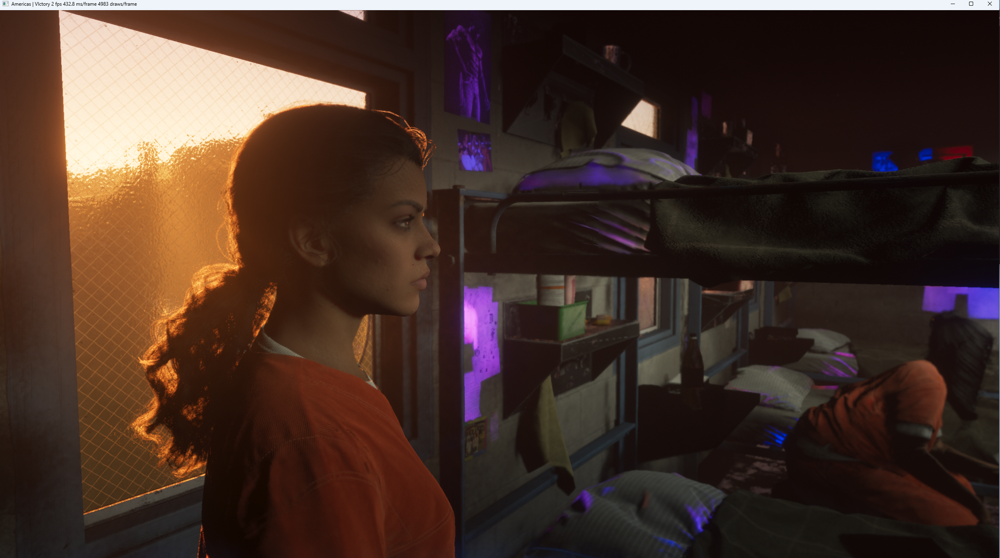
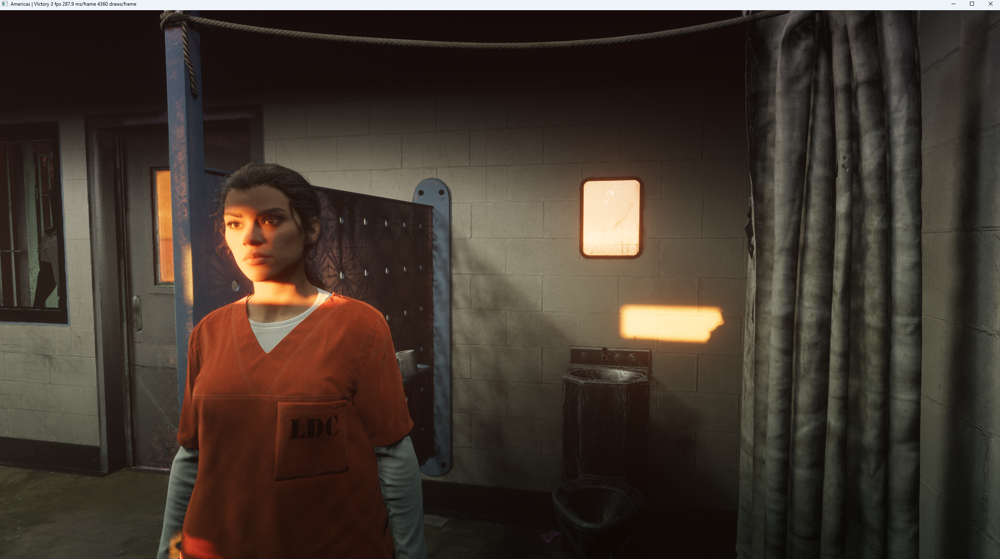

# VIctory: GTA VI on PC (RX 6800 XT build)

A Windows x64 compatibility layer that runs the Xbox Series build of Grand Theft Auto VI on a PC: the console's own
code runs natively, the layer provides the console's services and translates its GPU work (GFX10 shaders to DXIL)
for Direct3D 12. **You need your own legally obtained copy of the game**, already readable on disk. Nothing here
decrypts anything or works around any protection, and no game files are included or shared.

## Status (25 Nov 2026, tested on my AMD Radeon RX 6800 XT, i7-12700K, 32 GB, Windows 11)

| | Result |
|---|---|
| Boot, intro video, start screen, menus | work |
| Loading into the world | works, no failed DirectStorage reads |
| The world (prologue) | drawn and lit; characters complete; **textures almost all complete** |
| Speed in the world | **2.9-3.3 fps** (306-348 ms/frame), Series X mode, no upscaling |
| Stability | 17 min in the world without a crash or device removal |
| Memory | about 28 GB committed |

Screenshots from my RX 6800 XT (prologue, Series X mode, 2-3 fps shown in the window title):




Still wrong: low frame rate (CPU and GPU still wait for each other: being worked on); areas lit only by the
title's ray-traced light stay dark (its structure builders are not run yet).

## What this build adds

- **Title patches for 1.0.2.1** (in memory, the file is never touched): the title's hang detector, which ended the
  game after ~9 minutes of slow frames, and an audio lock after ~2 minutes. `VICTORY_PATCH_SKIP=<n>,...` drops them.
- **Textures:** uploaded placed textures are refreshed when DirectStorage writes their pages after the upload (walls
  and details that stayed missing for a whole run); higher mips written later reach the card; sharper views are not
  held back when the card is full; XOR-swizzled textures are uploaded; sRGB/SNORM view formats kept on castable
  copies (`VICTORY_TEXTURE_CAST`, on; an A8_UNORM view that removed the device is fixed); planar
  depth-stencil planes and block-compressed sizes that are not multiples of 4 are uploaded.
- **CPU/GPU waits:** settles for title memory changed under shader writes ask the page guards instead of assuming a
  write (`VICTORY_STALE_ASK`, on), and can wait only for the submissions concerned (`VICTORY_STALE_PRECISE=1`).
- **Being tested, off by default** (one of them dims interior or reflected light, being narrowed down): copies
  (`VICTORY_CARD_FETCH_INFLIGHT`, `VICTORY_RELAY_WIDE_MERGE`, `VICTORY_COPY_DIFF`, `VICTORY_HEAP_PASS_WIDE`), CPU recording
  caches (`VICTORY_DRAW_STATE_CACHE`, `VICTORY_TABLE_CACHE`, `VICTORY_RECORD_PARALLEL`, timings `VICTORY_RECORD_TIMING`),
  video memory (`VICTORY_UPLOAD_POOL`, `VICTORY_READBACK_POOL`, `VICTORY_READ_POOL`, `VICTORY_TEXTURE_KEEP_HASH`,
  `VICTORY_TEXTURE_DROP_STAGING`, `VICTORY_TEXTURE_LRU`) and geometry (`VICTORY_MS_EXCHANGE`, `VICTORY_RAW_OWN_COPY`,
  `VICTORY_HEAP_BUFFER_STATE`). Set one to `1` to try it.
- `VICTORY_TITLE_DIR`: the folder with the game's files when the executable is elsewhere.

## Build and run

Requirements: Windows 10/11 x64, an AVX2 CPU, a Direct3D 12 GPU with shader model 6.6 and mesh shaders, Rust.

```powershell
cargo build --release -p victory
```

Pre-build the shaders and pipelines once (about 10 minutes):

```powershell
$env:VICTORY_SHADER_OPT = '0'
$env:VICTORY_SKIP_PIPELINES = (Get-Content docs\skip-amd.txt -Raw).Trim()
target\release\victory.exe translate --cache --pipelines --jobs 8 <game dir>\shaders.rpf
```

Play (the settings I test with):

```powershell
$env:VICTORY_SHADER_OPT = '0'
$env:VICTORY_SKIP_PIPELINES = (Get-Content docs\skip-amd.txt -Raw).Trim()
$env:VICTORY_LATE_WAIT = '1'
$env:VICTORY_WIDE_BACK = '1'
$env:VICTORY_PIPELINE_WAIT_MS = '24'
$env:VICTORY_RELAY_COPY_QUEUE = '0'
$env:VICTORY_D3D12_DRED = '1'
$env:VICTORY_GAME_DIR = '<game dir>'
target\release\victory.exe run <game dir>\<the title's exe> --execute
```

`docs\skip-amd.txt` names the one shader that hangs the AMD driver's compiler (and leaks memory); it is skipped.
Press A on the start screen. Stay windowed.

## License

GPL-3.0, see [LICENSE](LICENSE). Product names are only used to say what this works with; they belong to their
owners. This project is not affiliated with them.
